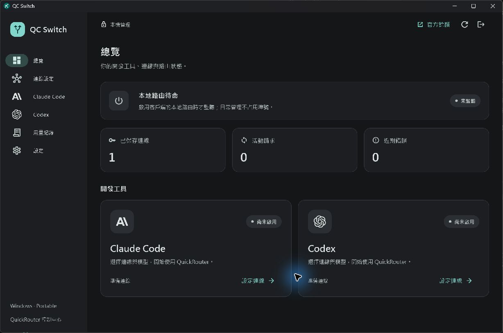

# QC Switch

[](https://github.com/Miku0139oao/QC-Switch/actions/workflows/windows.yml)

Windows x64 的 QuickRouter 控制工具。Flutter 原生 Material 3、繁體中文介面，Go 核心透過 stdio JSON-RPC 與 UI 通訊。只提供 portable 版，不需要安裝服務或管理員權限。



> 0.1.1 為預覽版。目前完成模擬上游與實際 Codex CLI 的隔離驗證；尚未使用真實 QuickRouter Key 驗收。各客戶端的驗證範圍見 [驗證紀錄](docs/VALIDATION.md)。

## 下載與使用

從 [GitHub Releases](https://github.com/Miku0139oao/QC-Switch/releases) 下載 portable ZIP；每次 main 分支建置也會在 [Actions](https://github.com/Miku0139oao/QC-Switch/actions/workflows/windows.yml) 提供 30 天的建置產物。

1. 完整解壓 ZIP 至可寫入的資料夾，執行 `QC Switch.exe`。保留旁邊的核心、DLL 與 `data` 目錄。
2. 在「連線設定」新增 QuickRouter Key，選擇 `https://api.quickrouter.ai`（預設）、`https://api.quickrouter.us` 或自訂 HTTPS 根地址／`/v1`。既有連線若誤填網站網域，按「改用 API 位址」即可保留 Key 與模型並修正。
3. 選擇上游協議，取得或手動輸入模型，設定工具、圖片、推理與上下文能力。清單中出現模型不代表 Key 有使用權限。
4. 按「測試連線」分別測試認證、文字、串流、工具。這些測試會發出 API 請求，文字／串流／工具測試可能產生費用。
5. 在 Claude Code 或 Codex 頁選擇連線、模型與模式，再按啟用。重新啟動相應 CLI、VS Code 擴充套件或 Codex 桌面程式。

程式不預選固定模型，也不自動切換節點。餘額按鈕開啟 QuickRouter 官方頁面；本機用量紀錄只顯示上游回報的 token，不作為帳戶結算。

## 連接埠與兩種模式

| 模式 | 本機監聽 | 用途 |
| --- | --- | --- |
| 管理 UI、模型取得、連線測試 | 無 | UI ↔ Go 使用匿名管線，Go 直接連上游 |
| 直連 | 無 | Claude → Messages、Codex → Responses；真正的 Key 會寫入客戶端設定 |
| 本地路由 | 僅 `127.0.0.1` | 協議轉換、用量紀錄、Key 隱藏及熱切換；預設埠 15722，可修改 |

只有明確啟用「本地路由」時才開啟 listener，成功監聽後才接管設定。最後一個路由解除後便停止監聽。退出程式會先還原兩種模式的客戶端設定。

路由支援以下六種組合，包含文字／圖片輸入、工具定義與結果、多輪完整歷史、並行工具、推理欄位及 SSE 串流：

| 客戶端 | Messages 上游 | Responses 上游 | Chat Completions 上游 |
| --- | --- | --- | --- |
| Claude Code | 原生 | 轉換 | 轉換 |
| Codex | 轉換 | 原生 | 轉換 |

Codex 維持 `wire_api = "responses"`；custom tools（含 `apply_patch`）在其他協議中包裝為 function tools。Chat 上游使用完整歷史重播；停用遠端搜尋。遠端壓縮項目不會冒充可轉換的歷史，請使用客戶端本地壓縮。上游仍須具備所選模型的工具／圖片能力；不支援的協議欄位會明確報錯。部分 QuickRouter 模型的工具呼叫需要 Responses。

每個請求開始時固定連線設定，切換後只有新請求使用新設定。串流取消會傳至上游；斷流標為失敗，不自動重送。上游 180 秒完全沒有傳入資料會終止該請求。

## 設定接管、資料與恢復

- Claude：`CLAUDE_CONFIG_DIR` 或 `~/.claude/settings.json`。
- Codex：`CODEX_HOME` 或 `~/.codex/config.toml`。使用獨立 `qc_switch` provider，保留 `auth.json` 與其他 provider。
- 兩者都可在 UI 覆寫設定目錄；已接管時需先解除才能改目錄。
- 修改前保存 DPAPI 加密原始快照與恢復日誌，以原子檔案替換寫入。保留 TOML 註解與無關設定。
- 解除接管比對每個欄位；外部修改不會直接被覆蓋。同欄位衝突時逐項選擇保留目前值或還原原始值。
- 異常結束後，下次啟動檢查恢復日誌；不自動啟用路由。環境變數診斷只反映 QC Switch 繼承到的環境，客戶端命令列、專案或受管政策仍可能覆蓋設定。

資料保存在執行檔旁的 **`user-data/`**。`data/` 是 Flutter runtime，兩者用途不同。SQLite 儲存設定與用量；Key 與設定快照以 **Windows 目前使用者的 DPAPI** 加密。複製 portable 程式不代表加密資料可以跨使用者或機器解密。

設定匯出不包含 Key、憑證、接管快照或使用內容。匯入只恢復連線與偏好選擇，不修改客戶端或啟用路由。更新版本前先從系統匣「還原設定並退出」，保留舊 `user-data`，再替換程式檔案。

關閉視窗會縮至系統匣並持續路由；點系統匣可顯示視窗、切換連線、啟停路由。再次執行 `QC Switch.exe` 也會找回原有視窗。明確退出才還原設定並停止核心。若核心故障，重新啟動以執行恢復；需要恢復前請保留整個 `user-data`。

## 開發與建置

需求：Windows 10/11 x64、Go 1.26.3、Flutter 3.47.7（Dart 3.13.5）、Visual Studio 2022 C++ Desktop 工具與 Windows SDK。

```powershell
go test ./...
go vet ./...
go build -o build/qc-switch-core.exe ./cmd/qc-switch-core
cd desktop
flutter pub get --enforce-lockfile
flutter analyze
flutter test
flutter run -d windows
```

完整檢查與 portable 打包：

```powershell
./scripts/build-portable.ps1
# Flutter 沒有加入 PATH 時：
./scripts/build-portable.ps1 -Flutter D:/DevTools/flutter/bin/flutter.bat
```

產物：`dist/QC-Switch-0.1.1-windows-x64-portable.zip` 與 `.sha256`。ZIP 包含 Go 核心、Flutter runtime、app-local VC++ runtime 及第三方授權。CI 執行相同腳本；推送 `v*` tag 會建立預覽版 release。

可選的實際 Codex CLI／模擬上游驗證（不需要真實 Key）：

```powershell
$env:QCSWITCH_CODEX_EXE = 'C:/path/to/codex.exe'
go test ./internal/app -run TestCodexCLIMockUpstreams -v -count=1
```

此測試使用獨立暫存設定與工作目錄，讓固定模擬回應執行測試讀寫操作；不載入原有 Codex config/auth。一般 `go test` 不執行此項。

程式碼位置：`internal/protocol` 協議、`internal/gateway` HTTP 路由、`internal/config` 接管恢復、`internal/store` SQLite、`internal/app` 管理契約、`desktop/lib` Flutter UI。契約見 [JSON-RPC](docs/RPC.md)。

## 參考與授權

- [QuickRouter 文件](https://doc.quickrouter.ai/docs/making-requests.html)
- [OpenAI gateway 設定](https://developers.openai.com/codex/enterprise/connect-to-a-gateway)
- [cc-switch 參考版本](https://github.com/farion1231/cc-switch/tree/79e754ab1b6ed50da57dae1d0faecab4b3b52f1c)

QC Switch 採用 [MIT](LICENSE)；cc-switch 原始授權與依賴聲明見 [THIRD_PARTY_NOTICES.md](THIRD_PARTY_NOTICES.md)。本專案為非官方工具。
